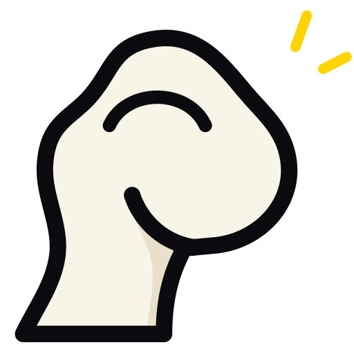

<div align="center">



# MycSs

### Your music, finally worthy of your Mac.

Synced lyrics **word by word** on the lock screen, and a **living notch** that gathers your music, your notifications and your everyday tools.


[Español](README.md)

</div>

---

## Install in a minute

```bash
brew tap frenkiieeee/mycss https://github.com/frenkiieeee/MycSs
brew install --cask mycss
```

Always up to date: `brew upgrade --cask mycss` brings each new release. Want what is on `main`? Install `mycss@nightly` instead and follow it with `brew upgrade --cask --greedy-latest mycss@nightly`. (If your Homebrew asks you to trust a third party tap: `brew trust frenkiieeee/mycss`.)

## What it does

- **Lyrics on the lock screen**, lit word by word, for Spotify, Apple Music and browser tabs (Chrome, Safari, Arc, Firefox, Zen...), with the cover, a clock and an animated background that follows the album colours. It also opens as a screensaver (⌃⌥L).
- **A notch that does much more than hide the camera**: music with cover and visualiser, instant notifications with a rule per app (notch, system or both) and a history that survives a restart, volume, brightness and keyboard light indicators, and widgets: calendar, reminders, a timer that drops under the notch, system, a clipboard with text and pictures, and a file shelf. It works on several screens.
- **Yours to the last detail**: fonts, highlight effect, clock, backgrounds, animations, notch size and timing. Save it all as a **style**, preview it live and undo whenever you want.
- **Private and free**: everything runs on your Mac, no accounts, no analytics, MIT licence.

## Requirements

macOS 15 or later, and Spotify or Apple Music. The full notch needs a Mac with a notch; other Macs get a pill at the top centre.

## Other ways to install

```bash
# one command, without Homebrew
curl -fsSL https://raw.githubusercontent.com/frenkiieeee/MycSs/main/install.sh | bash
```

Or download the `.dmg` from [Releases](https://github.com/frenkiieeee/MycSs/releases), drag MycSs to Applications and, the first time, right click > Open (the app is not notarized). To build from source you only need the Xcode Command Line Tools: `./build-app.sh`.

After an update macOS may ask again for Accessibility and Full Disk Access.

## Permissions

| Permission | Used for | Required |
|---|---|---|
| Automation (Spotify, Music) | Reading the current song | Yes |
| Accessibility | Volume and brightness keys in the notch, the keyboard light shortcut, and closing the system banner of apps set to "notch only" | No |
| Automation (browsers) | Reading and controlling the tab that plays (needs "Allow JavaScript from Apple Events" in Chrome, Safari and the like; Firefox and Zen need nothing) | No |
| Full Disk Access | Showing other apps' notifications in the notch | No |
| Calendars, Reminders | The calendar and reminders widgets | No |
| System audio | A visualiser that follows the real rhythm | No |

## Privacy

Everything runs on your Mac. Only the song title, artist and duration are sent, to LRCLIB, NetEase and QQ Music, to find the lyrics, and the title and artist to Deezer and Apple's catalogue when the player has no cover. With the browser on, the page's icon is downloaded from that site, without cookies. The update check runs only when you press the button. No analytics, no accounts.

## Contributing

See [CONTRIBUTING.md](CONTRIBUTING.md). The technical notes are in [docs/architecture/internals.md](docs/architecture/internals.md) (Spanish).

## License

[MIT](LICENSE) © 2026 Frenkiieeee. The notch is inspired by boring.notch (GPL-3.0); no code was copied from it. Lyrics belong to their authors.
