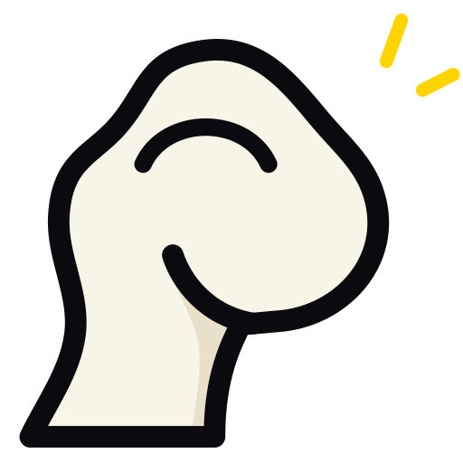

<div align="center">



# MycSs

### Tu música, por fin a la altura de tu Mac.

Letras sincronizadas **palabra a palabra** cuando bloqueas la pantalla, y un **notch vivo** que reúne tu música, tus avisos y tus herramientas del día a día.


**[Instalar](#instalar-en-un-minuto)** · [Qué hace](#qué-hace) · [Preguntas frecuentes](#preguntas-frecuentes) · [English](README.en.md)

</div>

---

## Instalar en un minuto

```bash
brew tap frenkiieeee/mycss https://github.com/frenkiieeee/MycSs
brew install --cask mycss
```

¿Prefieres un solo comando sin Homebrew? `curl -fsSL https://raw.githubusercontent.com/frenkiieeee/MycSs/main/install.sh | bash`. ¿O el instalador de siempre? Descarga el `.dmg` desde [Releases](https://github.com/frenkiieeee/MycSs/releases) y arrastra MycSs a Aplicaciones.

> Con Homebrew, **siempre al día**: `brew upgrade --cask mycss` trae cada versión nueva. Si quieres lo último que se publica en la rama principal, instala `mycss@nightly` y actualízalo con `brew upgrade --cask --greedy-latest mycss@nightly`.

## Qué hace

### Pon una canción y bloquea la Mac

La letra aparece en grande, **iluminada palabra a palabra** al ritmo de la voz, con la portada, un reloj elegante y un fondo animado que toma los colores del álbum. Sin tocar nada: funciona con **Spotify**, **Apple Music** y hasta con lo que suena en una pestaña del **navegador** (Chrome, Safari, Arc, Brave, Edge, Vivaldi, **Firefox y Zen**). También se abre como salvapantallas con un atajo (⌃⌥L).

### Un notch que hace mucho más que ocultar la cámara

- **Música a la vista**: portada y visualizador al lado del notch, y el título al cambiar de canción. Pulsa o apunta para abrirlo y controla la reproducción.
- **Avisos sin ruido**: las notificaciones llegan al notch al instante. Decide app por app si salen en el notch, en el sistema o en los dos, y revisa las últimas en el panel «Avisos», incluso después de reiniciar.
- **Volumen, brillo y luz del teclado** con indicadores propios, también en la pantalla de bloqueo.
- **Herramientas**: calendario (crea eventos pulsando la fecha), recordatorios, temporizador que baja bajo el notch, batería y sistema, portapapeles con texto e imágenes, y una estantería para arrastrar archivos.
- Funciona en **varias pantallas** y en **Macs sin notch**: allí vive arriba del todo, dentro de la barra de menús, y no se ve hasta que hay música, un aviso o algo que enseñar (o, si prefieres, como una isla flotante bajo la barra).

### Tuyo, hasta el último detalle

Fuente, efecto de resaltado, reloj, fondos, animaciones, tamaño y movimiento del notch, tiempos de apertura y de cierre... Guarda todo como un **estilo**, míralo en una vista previa en vivo antes de aplicarlo y vuelve atrás con «Deshacer» cuando quieras.

### De un vistazo

| | |
|---|---|
| **Letras** | Palabra a palabra, de varias fuentes, con tema de color sacado de la portada |
| **Reproductores** | Spotify, Apple Music y navegador, con un clic para pasar de uno a otro |
| **Notch** | Música, avisos, volumen, brillo, luz del teclado, widgets y estantería |
| **Estilos** | Cuatro de fábrica y los que crees tú, con vista previa |
| **Privacidad** | Todo en tu Mac, sin cuentas ni análisis de uso |
| **Coste** | Gratis y de código abierto (MIT) |

## Primeros pasos

1. Abre MycSs: aparece su icono en la barra de menús.
2. Pon música en Spotify, Apple Music o el navegador. macOS pedirá un permiso la primera vez.
3. Bloquea la Mac (⌃⌘Q) o pulsa **⌃⌥L** para ver las letras sin bloquear.
4. Abre **Preferencias** desde el menú de la barra y elige un estilo.

## Preguntas frecuentes

**¿Es gratis?** Sí, y de código abierto bajo licencia MIT.

**¿Funciona en mi Mac?** Necesita macOS 15 (Sequoia) o superior. Con notch, se funde con el recorte; sin él (como en los MacBook sin notch o en un monitor externo), se coloca arriba del todo, dentro de la barra de menús, invisible en reposo si quieres (o como una isla flotante bajo la barra). Para abrirla, lleva el puntero al centro del borde de arriba o usa «Abrir el notch» en el menú de MycSs.

**¿Por qué macOS avisa al abrirla?** MycSs aún no está notarizada por Apple. Con Homebrew o `install.sh` no verás el aviso; con el `.dmg`, haz clic derecho > Abrir la primera vez.

**¿Qué pasa con mi privacidad?** Todo ocurre en tu Mac. Solo sale la búsqueda de la letra (título, artista y duración) y, si hace falta, la de la portada. No hay cuentas, análisis de uso ni conexiones en segundo plano. [Más abajo](#privacidad) está el detalle.

**¿Por qué no encuentra la letra de una canción?** Algunas no están en ninguna fuente. MycSs lo intenta en varias y, si no hay letra, centra la portada.

**¿Puedo ver las notificaciones en el notch?** Sí, si concedes el permiso de Acceso total al disco (macOS no ofrece otra vía). Es opcional: sin él, el resto funciona igual.

**¿Cómo la desinstalo?** `brew uninstall --cask --zap mycss`, o `./scripts/uninstall.sh`. No deja nada atrás.

## Requisitos

- macOS 15 (Sequoia) o superior.
- Spotify, Apple Music o un navegador con algo sonando.
- Cualquier Mac: con notch se funde con el recorte; sin él vive arriba del todo, dentro de la barra de menús, o como isla flotante si lo eliges (Notch › Aspecto › «Pantallas sin notch»).

## Todas las formas de instalar

### Homebrew (recomendada: siempre al día)

```bash
brew tap frenkiieeee/mycss https://github.com/frenkiieeee/MycSs
brew install --cask mycss
```

Si tu Homebrew lo pide por ser un tap de terceros: `brew trust frenkiieeee/mycss`.

- **Versiones numeradas**: `brew upgrade --cask mycss`. Cada versión que se publica apunta sola al cask, sin esperar a nadie.
- **Rama principal (`main`)**: `brew install --cask mycss@nightly`. Se reconstruye con cada cambio y se actualiza con `brew upgrade --cask --greedy-latest mycss@nightly`. Es lo más nuevo, y puede fallar. No se pueden tener las dos a la vez.

### Un comando

```bash
curl -fsSL https://raw.githubusercontent.com/frenkiieeee/MycSs/main/install.sh | bash
```

Descarga la última versión, comprueba su suma sha256, la copia a `/Applications` y la abre. Opciones: `--version X.Y.Z`, `--prefix DIR`, `--from-source`. Léelo antes de ejecutarlo si prefieres: es corto.

### Desde el DMG

1. Descarga `MycSs-<versión>.dmg` de la página de [Releases](https://github.com/frenkiieeee/MycSs/releases).
2. Arrastra **MycSs** a Aplicaciones.
3. La primera vez, **clic derecho > Abrir > Abrir**: la app no está notarizada por Apple, y por eso macOS avisa. Si dice que está dañada, ejecuta `xattr -dr com.apple.quarantine /Applications/MycSs.app`.

### Desde el código

Hacen falta solo las Command Line Tools de Xcode (`xcode-select --install`), no Xcode.

```bash
git clone https://github.com/frenkiieeee/MycSs.git
cd MycSs
./build-app.sh        # compila y arma MycSs.app
open MycSs.app
```

### Actualizar y desinstalar

- Actualizar: `brew upgrade --cask mycss` (o `--greedy-latest` con `mycss@nightly`), o vuelve a ejecutar `install.sh`, o usa «Buscar actualizaciones» en Preferencias > Acerca de. **Tras actualizar, macOS puede pedir de nuevo** Accesibilidad y Acceso total al disco (la app no está notarizada y su firma cambia).
- Desinstalar: `brew uninstall --cask --zap mycss`, o `./scripts/uninstall.sh`. Quita la app, sus preferencias, la caché y los registros.

## Permisos

MycSs pide cada permiso **solo cuando lo necesita** y funciona sin los opcionales.

| Permiso | Para qué | Cuándo se pide |
|---|---|---|
| Automatización (Spotify, Música) | Leer la canción y la posición | Al reproducir por primera vez. **Imprescindible** |
| Accesibilidad | Teclas de volumen y brillo en el notch, el atajo de la luz del teclado y cerrar el aviso del sistema de las apps en «Solo notch» | Al activar el indicador del notch. Opcional |
| Automatización (navegadores) | Leer y controlar la pestaña que suena en Chrome, Safari y similares. Firefox y Zen no piden nada | La primera vez que MycSs lee un navegador abierto (se puede quitar en General › Reproductor). Opcional |
| Acceso total al disco | Ver las notificaciones de otras apps en el notch | Si lo activas en Notch > Avisos. Opcional |
| Calendarios | Eventos del widget de calendario | Al abrir ese widget. Opcional |
| Recordatorios | Widget de recordatorios | Al abrir ese widget. Opcional |
| Audio del sistema | Visualizador que sigue el ritmo real | Si activas «seguir el ritmo». Opcional |

## Privacidad

Todo ocurre en tu Mac. Lo único que sale es:

- La **búsqueda de la letra**: título, artista y duración de la canción a [LRCLIB](https://lrclib.net), NetEase Cloud Music y QQ Music. Las letras se guardan en `~/Library/Caches/MycSs`; no se redistribuyen.
- La **búsqueda de la portada** cuando el reproductor no la da: título y artista a los catálogos públicos de Deezer y Apple. Se guardan en `~/Library/Caches/MycSs/Covers2`.
- Con el navegador activado, el **icono de la página** que suena se descarga de esa misma web, sin cookies. De una pestaña solo se busca letra si la página dice el artista (los sitios de música lo hacen); el título de cualquier otra página no sale de tu Mac.
- La comprobación de versión, **solo si pulsas** «Buscar actualizaciones» (una consulta a la API pública de GitHub, sin datos tuyos).

No hay análisis de uso, cuentas ni conexiones en segundo plano. Los eventos, recordatorios y notificaciones se leen en local y no se envían a ningún sitio.

## Solución de problemas

- **No aparece la letra al bloquear.** Mira el registro: `tail -f ~/Library/Logs/MycSs.log` (o Preferencias > Acerca de > Abrir el registro). Comprueba que la canción suena y que concediste Automatización.
- **Una canción no tiene letra.** Algunas no están en ninguna fuente; MycSs reintenta y centra la portada. El banco de pruebas (`MycSs --lyrics-bench`) mide cuántas canciones conocidas encuentra.
- **El navegador no aparece.** Activa en él «Permitir JavaScript desde eventos de Apple» (Chrome: Ver › Opciones para desarrolladores; Safari: menú Desarrollo). General › Reproductor dice qué falta en cada uno. Firefox y Zen no necesitan ese ajuste.
- **Una canción tiene la portada de otra.** General › Reproductor › «Borrar las guardadas»; se vuelven a buscar.
- **Se perdieron Accesibilidad o Acceso total al disco tras actualizar.** Es normal sin notarización: vuelve a concederlos en Ajustes del Sistema > Privacidad y seguridad. Para Acceso total al disco, MycSs no aparece solo en la lista: añádelo con «+».
- **El notch no se ve en una pantalla.** Notch > «Pantallas» elige solo la del Mac o todas.
- **No arranca / se cierra.** Mira `~/Library/Logs/DiagnosticReports` y abre una incidencia con el registro.

## Para quien quiera ver o tocar el código

- [`docs/README.md`](docs/README.md): índice de la documentación (specs, decisiones, marca).
- [`docs/architecture/internals.md`](docs/architecture/internals.md): cómo funciona por dentro (lectura de la música, retardo, notch, permisos, trampas).
- [`CONTRIBUTING.md`](CONTRIBUTING.md): cómo compilar, probar y qué reglas seguir.
- [`CHANGELOG.md`](CHANGELOG.md) y [`docs/RELEASING.md`](docs/RELEASING.md): versiones y cómo se publica una.

```bash
./scripts/verify.sh           # compila, autoprueba y comprueba los enlaces de la documentación
./scripts/verify.sh --notch   # además abre el notch real y pulsa sus controles
```

## Hoja de ruta

- Notarización con Developer ID (sin avisos al abrir ni permisos perdidos al actualizar).
- Capturas y GIFs de la app en este README.
- Más widgets y más fuentes de letras.

## Licencia y créditos

[MIT](LICENSE) © 2026 Frenkiieeee.

- El notch se inspira en [boring.notch](https://github.com/TheBoredTeam/boring.notch) (GPL-3.0). **No se copió código suyo**; solo la idea de producto.
- Letras de [LRCLIB](https://lrclib.net) (CC0), NetEase Cloud Music y QQ Music (endpoints no documentados; si dejan de responder, la app sigue con LRCLIB). Las letras pertenecen a sus autores.
- Mascota y marca: Frenkiieeee (ver [`docs/brand/frenkiieeee.md`](docs/brand/frenkiieeee.md)). Tipografía Nunito, licencia OFL.
